

  <picture>
    <source media="(prefers-reduced-motion: reduce)" srcset="./assets/profile-hero.png" />
    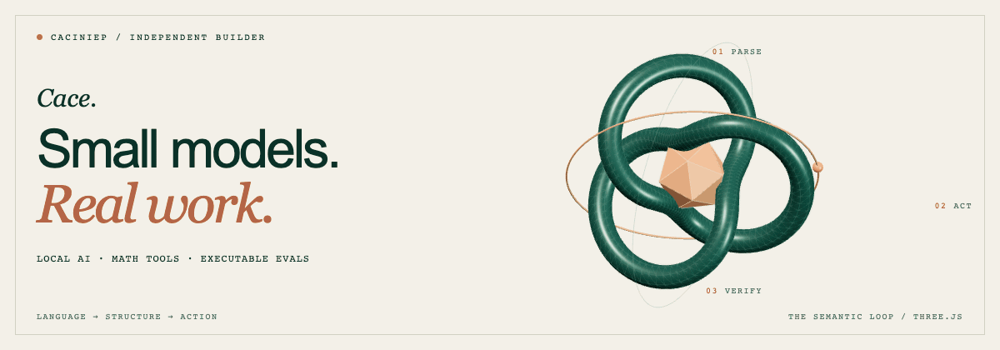
  </picture>

  <strong>Building local-first AI tools and reliable agents.</strong> 
  Small-model tool use, multimodal math writing, and executable evaluation. Linguistic training informs how I parse intent, organize context, and design tool interfaces.

  <a href="https://caciniep.github.io/">Portfolio</a> ·
  <a href="https://linguistwantstech.online/">Field notes</a> ·
  <a href="mailto:cacinie@gmail.com">Email</a> ·
  <a href="./README.md">中文</a>

---

## Codetics / 语码游戏

<a href="https://codetics.vercel.app/">
  <picture>
    <source media="(prefers-reduced-motion: reduce)" srcset="./assets/projects/codetics-scene.png" />
    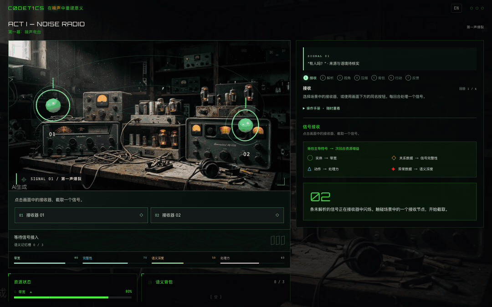
  </picture>
</a>

Four scenes: signal reception, semantic tagging, rhetoric, and Babel

<a href="https://codetics.vercel.app/">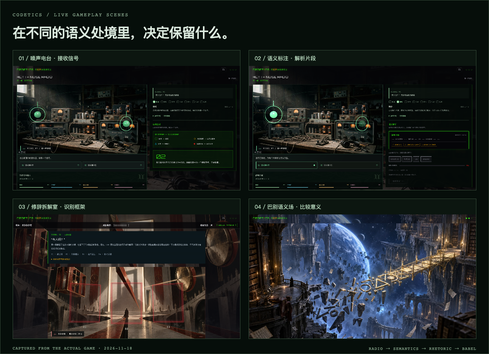</a>

**Reconstruct meaning through noise.**

Receive signals in the noise radio, tag semantic units, choose compression strategies, examine rhetoric, and explore Babel’s semantic fields. Linguistics and information theory become playable rules: when messages are compressed, misread, and retold, how much meaning can a civilization retain?

[Enter Codetics ↗](https://codetics.vercel.app/) · Chinese / English · Progress saved in this browser · Includes the short story “仍在唱歌的空城”

## Math & language tools

<table>
<tr>
<td width="50%" valign="top"><a href="https://github.com/CacinieP/TeXada-the-Math-Agent">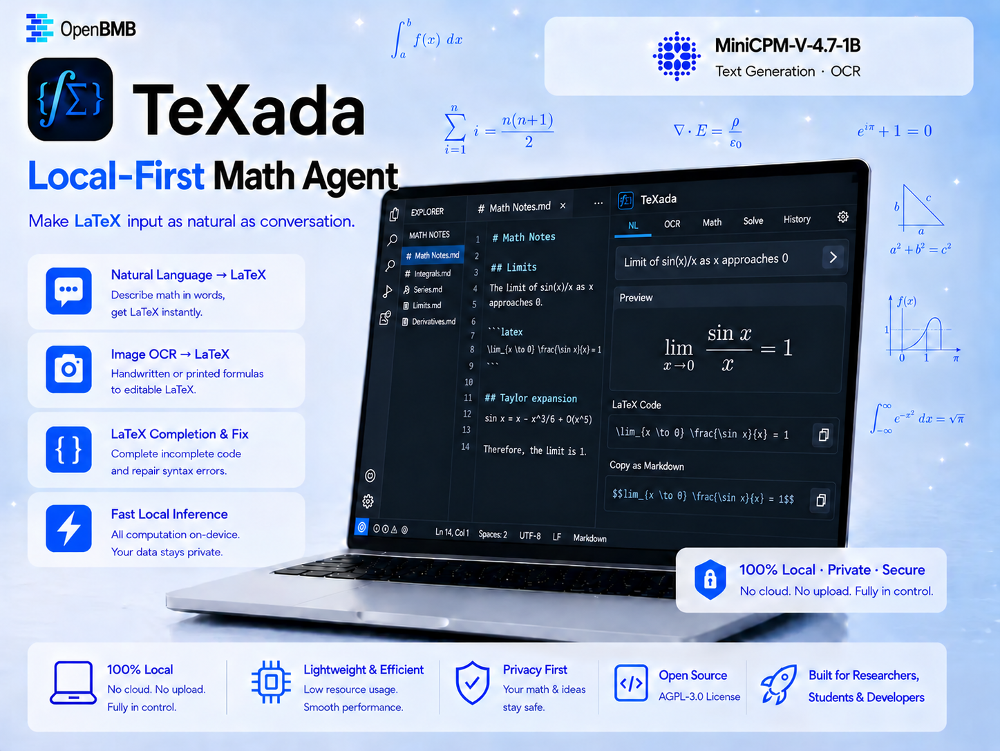</a>
<strong><a href="https://github.com/CacinieP/TeXada-the-Math-Agent">TeXada</a></strong>

Natural language, screenshots, and LaTeX → checked formula candidates, with specialist tools for validation, repair, and rendering.

<a href="https://github.com/CacinieP/TeXada-the-Math-Agent/releases">Download ↗</a> · <a href="https://openbmb.cn/docs/en/showcase/texada-math-agent">OpenBMB · Developer Showcase ↗</a>
</td>
<td width="50%" valign="top"><a href="https://github.com/CacinieP/TeXada-Studio-with-agentskills">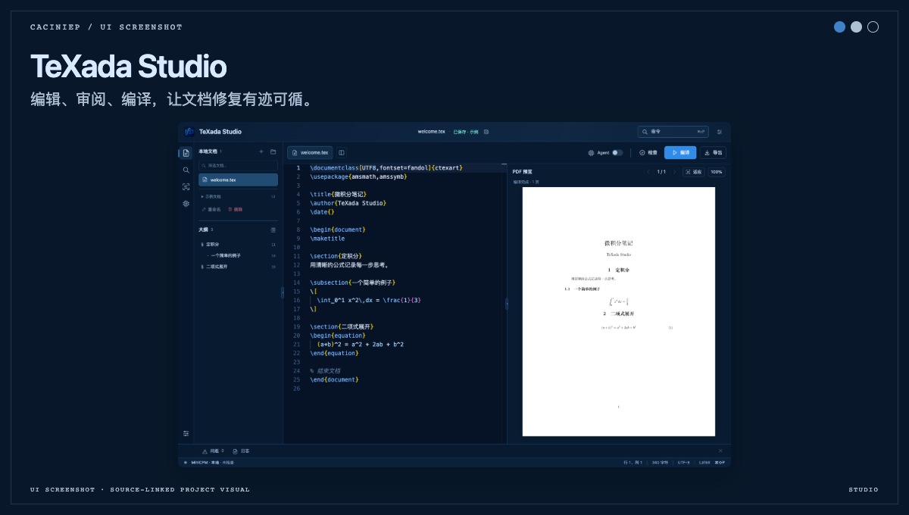</a>
<strong><a href="https://github.com/CacinieP/TeXada-Studio-with-agentskills">TeXada Studio</a></strong>

Local editing, candidate diffs, human review, and PDF compilation/export. Currently a development candidate.

<a href="https://github.com/CacinieP/TeXada-Studio-with-agentskills/blob/main/docs/current-validation.md">Validation ↗</a>
</td>
</tr>
<tr>
<td width="50%" valign="top"><a href="https://github.com/CacinieP/launchgrid">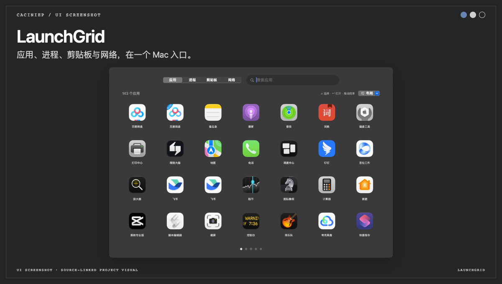</a>
<strong><a href="https://github.com/CacinieP/launchgrid">LaunchGrid</a></strong>

A Mac launcher with process, clipboard, and network panels.

<a href="https://github.com/CacinieP/launchgrid/releases">Download ↗</a>
</td>
<td width="50%" valign="top"><a href="https://github.com/CacinieP/lang-master">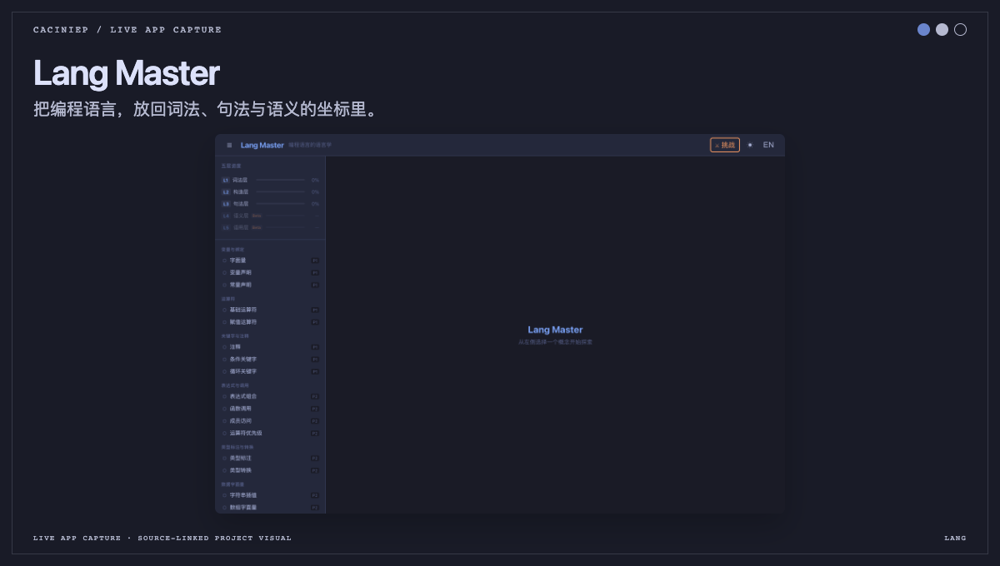</a>
<strong><a href="https://github.com/CacinieP/lang-master">Lang Master</a></strong>

Explore programming languages through lexicon, morphology, syntax, semantics, and pragmatics.

<a href="https://caciniep.github.io/lang-master/">Try online ↗</a>
</td>
</tr>
</table>

## SMAB / Executable small-model evaluation

**Trace each failure back to a protocol, an action, and a recorded run.**

- **Separate model capability from protocol fit.** Probe endpoint support for tools, templates, and structured output before comparing native and JSON paths, reducing confusion between runtime differences and model capability.
- **Locate the failing step.** Inspect selection, arguments, dependencies, state, recovery, and stopping; compare task horizons with full tool traces.
- **Measure repeatability.** Keep every run and report the mean, standard deviation, and pass^k to examine repeated success on the same tasks.
- **Iterate locally with controlled tasks.** Short bilingual cases and deterministic tool fixtures support comparisons of small models, quantization, and prompts without real business side effects.

[Run SMAB](https://github.com/CacinieP/SMAB#快速开始) · [Protocol adaptation](https://github.com/CacinieP/SMAB/blob/main/docs/FRAMEWORK_ADAPTATION.md) · [Raw traces & repeated runs](https://github.com/CacinieP/SMAB/tree/main/docs/evidence/minicpm-local-r3-2026-11-16)

## SUSHI / 溯时 · Time, served one plate at a time

[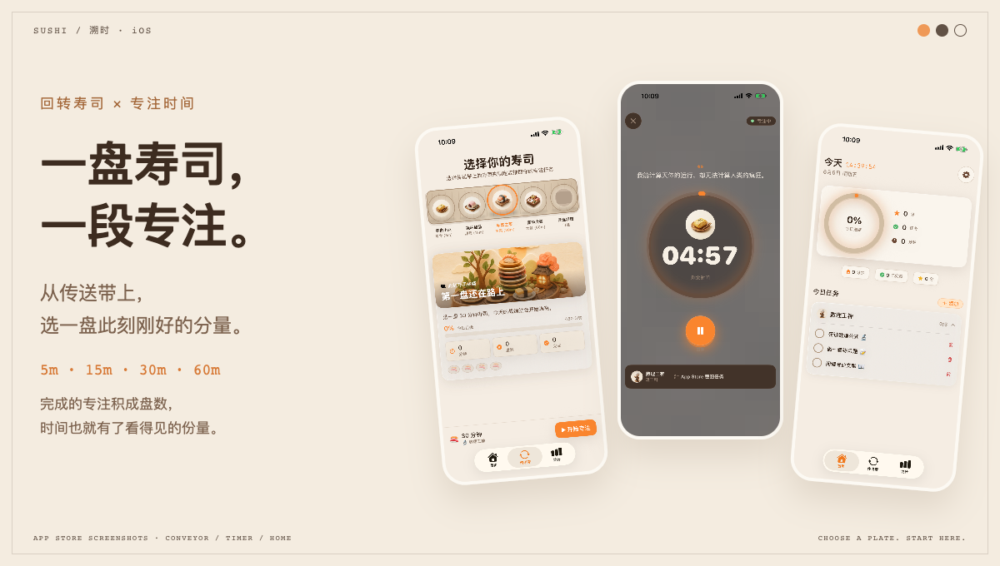](https://apps.apple.com/app/id6779997923)

**Conveyor-belt sushi is the metaphor behind its focus sessions.**

Different portions of focus pass in front of you: a 5-minute bite, a 15-minute dessert, a 30-minute main, a 60-minute feast, or a custom duration. Pick a plate that fits your energy, attach or draw a task, and begin one concrete session.

Completed sessions accumulate as plates; tasks, guardians, and notes retain what you spent that time on. The question becomes: which plate would you like to pick up now?

[Download on the App Store ↗](https://apps.apple.com/app/id6779997923) · iOS / iPadOS · Local data · No login

## Agent skills & data tools

<table>
<tr>
<td width="50%" valign="top"><a href="https://github.com/CacinieP/slide-recipes">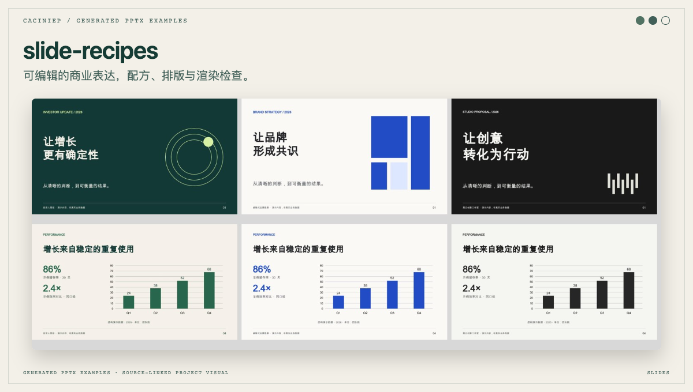</a>
<strong><a href="https://github.com/CacinieP/slide-recipes">slide-recipes</a></strong>

Editable PPTX recipes for agents, with CJK layout and render checks.

<a href="https://github.com/CacinieP/slide-recipes#readme">Usage ↗</a>
</td>
<td width="50%" valign="top"><a href="https://github.com/CacinieP/video2knowledge">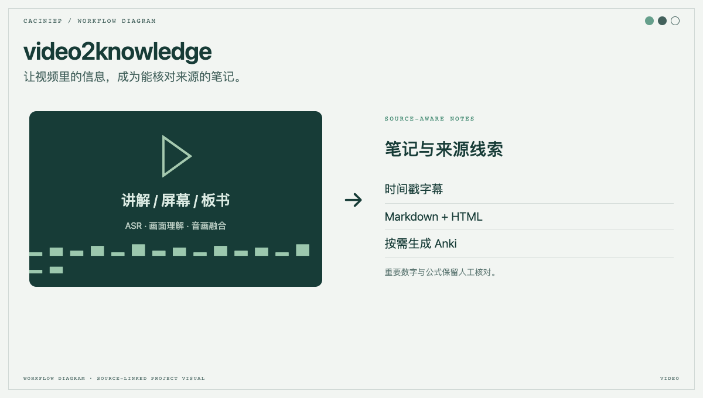</a>
<strong><a href="https://github.com/CacinieP/video2knowledge">video2knowledge</a></strong>

Turn videos into source-linked notes, with optional subtitles, HTML, and Anki.

<a href="https://github.com/CacinieP/video2knowledge/tree/main/example">Example outputs ↗</a>
</td>
</tr>
<tr>
<td width="50%" valign="top"><a href="https://github.com/CacinieP/minicpm5-network-doctor">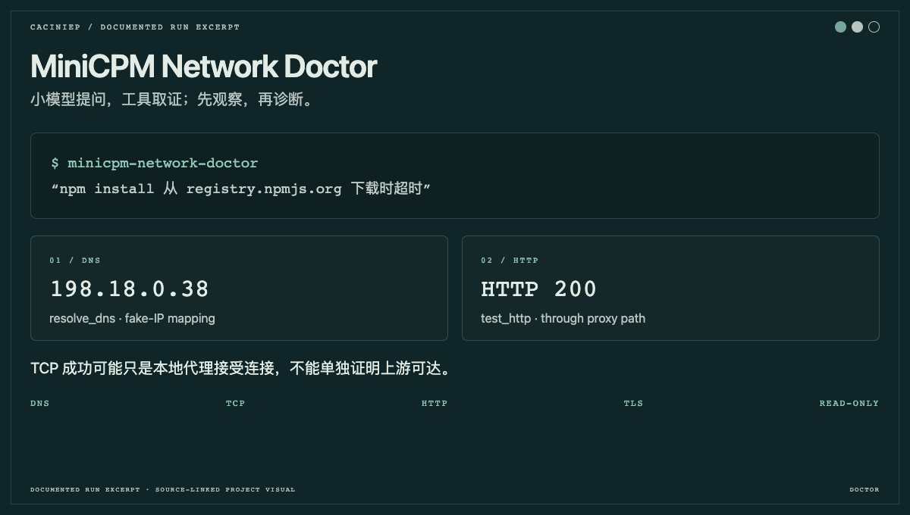</a>
<strong><a href="https://github.com/CacinieP/minicpm5-network-doctor">MiniCPM Network Doctor</a></strong>

Read-only network diagnostics with local models and traceable tool evidence.

<a href="https://github.com/CacinieP/minicpm5-network-doctor#readme">Source & guide ↗</a>
</td>
<td width="50%" valign="top"><a href="https://github.com/CacinieP/FinancialBeancount">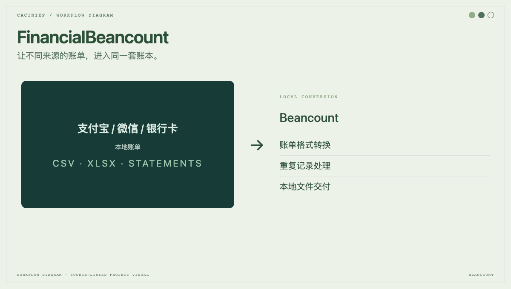</a>
<strong><a href="https://github.com/CacinieP/FinancialBeancount">FinancialBeancount</a></strong>

Local conversion and deduplication of Alipay, WeChat Pay, and bank statements.

<a href="https://github.com/CacinieP/FinancialBeancount#readme">Usage ↗</a>
</td>
</tr>
</table>

## Selected contributions

Upstream work on toolchain fixes, tests, and documentation. Only merged PRs appear below, with relevant engineering work listed first; each link leads to the actual change.

<!-- START: oss-contributions -->
<!-- This block is auto-generated by .github/workflows/update-contributions.yml — do not edit by hand. -->
_10 merged PRs across 5 repos · auto-updated daily._

| Project | My merged PRs |
|---|---|
| [**cc-switch**](https://github.com/farion1231/cc-switch) | [#7099](https://github.com/farion1231/cc-switch/pull/7099) — fix(claude): allow npm scripts in the primary update path |
| [**Step-Code**](https://github.com/stepfun-ai/Step-Code) | [#16](https://github.com/stepfun-ai/Step-Code/pull/16) — test: add comprehensive test suite (848 tests, 11 files) |
| [**rust**](https://github.com/rust-lang/rust) | [#160538](https://github.com/rust-lang/rust/pull/160538) — Update expect messages in tcp.rs doc examples to follow the style guide |
| [**agent-skills-with-anthropic**](https://github.com/datawhalechina/agent-skills-with-anthropic) | [#1](https://github.com/datawhalechina/agent-skills-with-anthropic/pull/1) [#5](https://github.com/datawhalechina/agent-skills-with-anthropic/pull/5) [#8](https://github.com/datawhalechina/agent-skills-with-anthropic/pull/8) |
| [**video-devour**](https://github.com/datawhalechina/video-devour) | [#24](https://github.com/datawhalechina/video-devour/pull/24) [#28](https://github.com/datawhalechina/video-devour/pull/28) [#29](https://github.com/datawhalechina/video-devour/pull/29) [#30](https://github.com/datawhalechina/video-devour/pull/30) |
<!-- END: oss-contributions -->

## Research & learning

Math, language, and inference systems: notes, experiments, and other projects

The images below are project content diagrams.

<table>
<tr>
<td width="50%" valign="top"><a href="https://github.com/CacinieP/inference-optimization-index">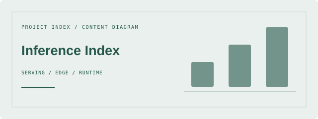</a>
<a href="https://github.com/CacinieP/inference-optimization-index"><strong>Inference optimization index</strong></a> Serving, edge, and general inference resources.
</td>
<td width="50%" valign="top"><a href="https://github.com/CacinieP/agent-self-evolution">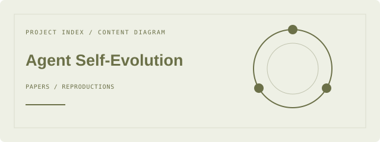</a>
<a href="https://github.com/CacinieP/agent-self-evolution"><strong>Agent self-evolution</strong></a> Papers, reproductions, and prototypes.
</td>
</tr>
<tr>
<td width="50%" valign="top"><a href="https://github.com/CacinieP/AgentEvalOps">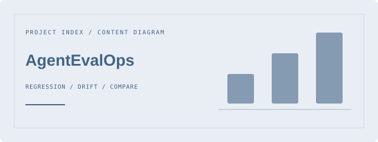</a>
<a href="https://github.com/CacinieP/AgentEvalOps"><strong>AgentEvalOps</strong></a> A UI prototype for regression, drift, and run comparison.
</td>
<td width="50%" valign="top"><a href="https://github.com/CacinieP/math-to-deep-learning">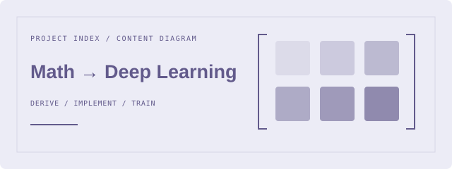</a>
<a href="https://github.com/CacinieP/math-to-deep-learning"><strong>Math to deep learning</strong></a> From paper derivations to GPU training.
</td>
</tr>
</table>

<table>
<tr>
<td width="50%" valign="top"><a href="https://github.com/CacinieP/Mathematics-Universe">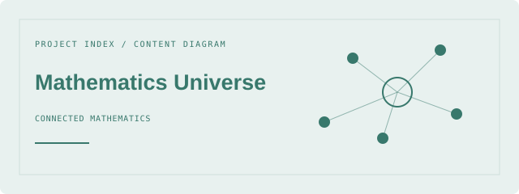</a>
<a href="https://github.com/CacinieP/Mathematics-Universe"><strong>Mathematics Universe</strong></a> Connections across school and entrance-exam mathematics.
</td>
<td width="50%" valign="top"><a href="https://github.com/CacinieP/MathConnect">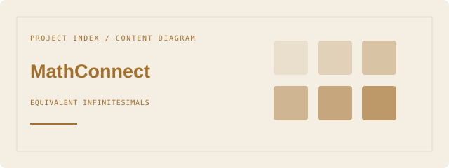</a>
<a href="https://github.com/CacinieP/MathConnect"><strong>MathConnect</strong></a> A matching game for equivalent infinitesimals.
</td>
</tr>
<tr>
<td width="50%" valign="top"><a href="https://github.com/CacinieP/linguistics-hackathon-S0-deutsch">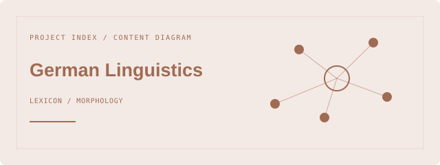</a>
<a href="https://github.com/CacinieP/linguistics-hackathon-S0-deutsch"><strong>German linguistics hackathon</strong></a> A solo 48-hour language-learning experiment.
</td>
<td width="50%" valign="top"><a href="https://github.com/CacinieP/typing-master">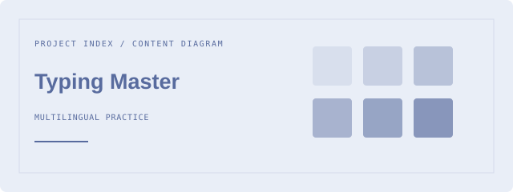</a>
<a href="https://github.com/CacinieP/typing-master"><strong>Typing Master</strong></a> Multilingual typing practice.
</td>
</tr>
</table>

<table>
<tr>
<td width="50%" valign="top"><a href="https://github.com/CacinieP/music-research">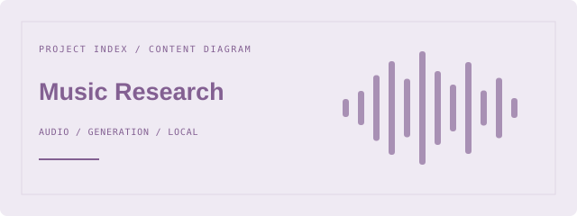</a>
<a href="https://github.com/CacinieP/music-research"><strong>Music research</strong></a> Music understanding, generation, audio, and local deployment.
</td>
<td width="50%" valign="top"><a href="https://github.com/CacinieP/FinancialBeancount">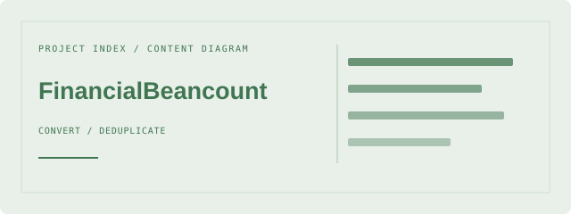</a>
<a href="https://github.com/CacinieP/FinancialBeancount"><strong>FinancialBeancount</strong></a> Local statement conversion and deduplication.
</td>
</tr>
<tr>
<td width="50%" valign="top"><a href="https://github.com/CacinieP/CICPA-Learning">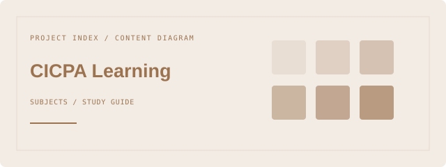</a>
<a href="https://github.com/CacinieP/CICPA-Learning"><strong>CPA learning guide</strong></a> Subject indexes and study resources.
</td>
<td width="50%" valign="top"><a href="https://github.com/CacinieP/LPQE-Learning">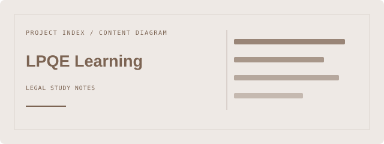</a>
<a href="https://github.com/CacinieP/LPQE-Learning"><strong>Legal qualification notes</strong></a> Study notes for the legal qualification exam.
</td>
</tr>
</table>

**Working stack** · Python / TypeScript / Swift / Rust · MCP / Tool Use / VLM / ASR · Tauri / React / GitHub Actions

---

[All repositories](https://github.com/CacinieP?tab=repositories) · [Portfolio](https://caciniep.github.io/) · [Contact](mailto:cacinie@gmail.com)
