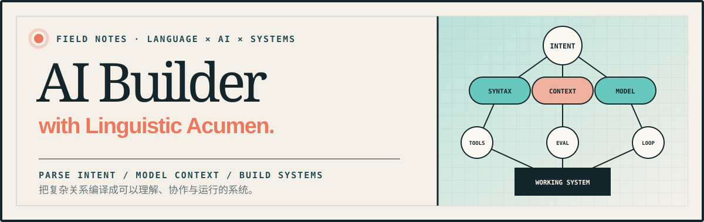

<p align="center">
  
</p>

<p align="center">
  <strong>AI Builder with Linguistic Acumen</strong><br/>
  <sub>用语言学的敏锐度，构建 Agent、开发者工具与学习系统。</sub>
</p>

<p align="center">
  <a href="https://caciniep.github.io/"></a>
  <a href="https://linguistwantstech.com/"></a>
  <a href="https://linguistwantstech.online/"></a>
  <a href="https://github.com/CacinieP?tab=followers"></a>
  <a href="./README.en.md"></a>
</p>

---

### `FEATURED / PIXEL-ART WEB DESIGN`

**[pixel-art-web-design](https://github.com/CacinieP/pixel-art-web-design)** —— Agent Skills 格式的像素风网页设计技能：从网格、色板、字体、精灵缩放到组件、动效与交付检查的完整 SOP。配套原创可玩游戏[《萤灯邮差 · Lantern Post》](https://github.com/CacinieP/lantern-post)由该技能完成，已部署 GitHub Pages。

<p align="center">
  <a href="https://caciniep.github.io/lantern-post/"></a>
  <a href="https://github.com/CacinieP/pixel-art-web-design"></a>
  <a href="https://github.com/CacinieP/pixel-art-web-design/blob/main/SKILL.md"></a>
</p>

<p align="center">
  <a href="https://caciniep.github.io/lantern-post/"></a>
</p>

安装：`npx skills add https://github.com/CacinieP/pixel-art-web-design.git -g` · [MIT](https://github.com/CacinieP/pixel-art-web-design/blob/main/LICENSE)

---

### `00 / AI AGENTS & EVALUATION`

**Agent 如何成为可靠的行动者？**

当前关注本地优先的工具调用、Agent 评测与自演化。重点不是让模型生成更多表达，而是让系统在有限上下文、明确权限与真实反馈中仍能可靠行动。

`MAP CAPABILITY BOUNDARIES` → `DESIGN TOOL GRAMMARS` → `MEASURE TASK ENTROPY` → `CLOSE THE LOOP`

| PROJECT | PURPOSE | SIGNAL |
|---|---|---|
| [**TeXada**](https://github.com/CacinieP/TeXada-the-Math-Agent) | 自然语言 / LaTeX / 公式截图统一进入可校验的数学写作流。 | [](https://github.com/CacinieP/TeXada-the-Math-Agent) |
| [**TeXada Studio**](https://github.com/CacinieP/TeXada-Studio-with-agentskills) | LaTeX 文档质检与候选修复工作台：规则检查 + 本地模型 + 编译预览 + 人工审阅闭环。 | [](https://github.com/CacinieP/TeXada-Studio-with-agentskills) |
| [**AgentEvalOps**](https://github.com/CacinieP/AgentEvalOps) | 展示 Agent 回归测试、漂移检测、运行对比与质量分析工作流的前端原型。 | [LIVE PROTOTYPE ↗](https://agent-bench-umber.vercel.app/) · [](https://github.com/CacinieP/AgentEvalOps) |
| [**SMAB**](https://github.com/CacinieP/SMAB) | 面向小型工具调用语言模型的可执行基准。 | [](https://github.com/CacinieP/SMAB) |
| [**MiniCPM5 Network Doctor**](https://github.com/CacinieP/minicpm5-network-doctor) | MiniCPM5 工具调用驱动的本地只读网络诊断 Agent。 | [](https://github.com/CacinieP/minicpm5-network-doctor) · `LOCAL-FIRST` |
| [**agent-self-evolution**](https://github.com/CacinieP/agent-self-evolution) | Agent 自演化论文、复现与原型档案。 | [](https://github.com/CacinieP/agent-self-evolution) · `RESEARCH` |

### `01 / CREATOR & DEVELOPER TOOLS`

| PROJECT | PURPOSE | SIGNAL |
|---|---|---|
| [**LaunchGrid**](https://github.com/CacinieP/launchgrid) | macOS 26/27 启动台替代：F4 应用网格、⌥F4 进程管理、⇧F4 剪贴板历史回贴、⇧⌥F4 网络面板；Swift 单包无第三方依赖，签名公证发 DMG。 | [](https://github.com/CacinieP/launchgrid) · `NOTARIZED` |
| [**video2knowledge**](https://github.com/CacinieP/video2knowledge) | 视频 → 时间戳字幕 → 知识文档 / HTML / Anki；多模态与 ASR 本地路径。 | [](https://github.com/CacinieP/video2knowledge) |
| [**slide-recipes**](https://github.com/CacinieP/slide-recipes) | 面向 AI Agent 的可编辑商业 PPTX：9 套审美 recipe、20 套语义配色、中文排版与渲染检查。 | [](https://github.com/CacinieP/slide-recipes) |
| [**NetAssist**](https://github.com/CacinieP/NetAssist) | 基于 Tauri + React 的网络诊断与监控桌面工具，支持连通性检测、实时监控、DNS 查询与端口扫描。 | [](https://github.com/CacinieP/NetAssist) |
| [**network-troubleshoot-skill**](https://github.com/CacinieP/network-troubleshoot-skill) | 面向 AI 编程 Agent 的通用网络排障技能。 | [](https://github.com/CacinieP/network-troubleshoot-skill) · [已收录](https://github.com/PatrickJS/awesome-cursorrules/pull/292) |
| [**pixel-art-web-design**](https://github.com/CacinieP/pixel-art-web-design) | Agent Skills 格式的像素风网页设计 SOP：网格、色板、字体、精灵缩放、组件与交付检查。 | [](https://github.com/CacinieP/pixel-art-web-design) · [SKILL.md](https://github.com/CacinieP/pixel-art-web-design/blob/main/SKILL.md) |
| [**FinancialBeancount**](https://github.com/CacinieP/FinancialBeancount) | 支付宝、微信、银行卡账单的本地转换与去重。 | [](https://github.com/CacinieP/FinancialBeancount) · [已收录](https://github.com/siddhantgoel/awesome-beancount/pull/76) |
| [**typing-master**](https://github.com/CacinieP/typing-master) | 六种语言的多语言打字练习桌面应用。 | [](https://github.com/CacinieP/typing-master) |
| [**Lang Master**](https://github.com/CacinieP/lang-master) | 从自然语言学视角学习编程语言，通过对照词法、构造、句法、语义与语用，理解同一概念在不同语言中如何表达和运作。Alpha 支持探索 Python、C、Java 和 Rust。 | [在线体验 ↗](https://caciniep.github.io/lang-master/) · [](https://github.com/CacinieP/lang-master) |
| [**cace-timer**](https://github.com/CacinieP/cace-timer) | 本地优先的时间追踪 CLI，支持标记、预估、搜索与同步。 | [](https://github.com/CacinieP/cace-timer) |
| [**screenshot-auto-saver**](https://github.com/CacinieP/screenshot-auto-saver) | 网页自动截屏 Chrome 扩展。 | [](https://github.com/CacinieP/screenshot-auto-saver) |
| [**PyRecorder**](https://github.com/CacinieP/PyRecorder) | 用 Python 实现的轻量 Windows 录屏工具。 | [](https://github.com/CacinieP/PyRecorder) |

### `02 / SHIPPED & INTERACTIVE`

| PROJECT | EXPERIENCE | ACCESS |
|---|---|---|
| **溯时 SUSHI** | 可回溯的 iOS 计时体验。 | [APP STORE ↗](https://apps.apple.com/cn/app/%E6%BA%AF%E6%97%B6/id6779997923) |
| **Codetics / 语码游戏** | 关于噪声、压缩、认知偏误与意义保存的互动叙事实验。 | [**▶ 立即游玩 ↗**](https://codetics.vercel.app/) |
| [**萤灯邮差 · Lantern Post**](https://github.com/CacinieP/lantern-post) | 用 pixel-art-web-design 技能完成的像素投递游戏：三条邮路、护符升级、触屏操作与芯片音效。 | [**▶ 立即游玩 ↗**](https://caciniep.github.io/lantern-post/) · [](https://github.com/CacinieP/lantern-post) |
| [**MathConnect**](https://github.com/CacinieP/MathConnect) | 练习等价无穷小的微积分连连看。 | [在线体验 ↗](https://caciniep.github.io/MathConnect/) · [](https://github.com/CacinieP/MathConnect) |
| [**FemaleFriendliness**](https://github.com/CacinieP/FemaleFriendliness) | 女性友好度自测互动页面。 | [](https://github.com/CacinieP/FemaleFriendliness) |
| [**resume**](https://github.com/CacinieP/resume) | 个人履历网页。 | [在线查看 ↗](https://caciniep.github.io/resume/) · [](https://github.com/CacinieP/resume) |

### `03 / KNOWLEDGE & RESEARCH`

| PROJECT | FOCUS | SIGNAL |
|---|---|---|
| [**inference-optimization-index**](https://github.com/CacinieP/inference-optimization-index) | 推理优化学习索引：服务端 LLM 推理 + 端侧/通用推理的仓库、书、课程与论文，链接逐条实测。 | [](https://github.com/CacinieP/inference-optimization-index) |
| [**CICPA-Learning**](https://github.com/CacinieP/CICPA-Learning) | 2026 注册会计师考试开源学习手册、科目索引与资料体系。 | [](https://github.com/CacinieP/CICPA-Learning) |
| [**LPQE-Learning**](https://github.com/CacinieP/LPQE-Learning) | 法律职业资格考试学习笔记。 | [](https://github.com/CacinieP/LPQE-Learning) |
| [**music-research**](https://github.com/CacinieP/music-research) | 音乐理解、生成、音频工程与端侧部署研究笔记。 | [](https://github.com/CacinieP/music-research) |
| [**linguistics-hackathon-S0-deutsch**](https://github.com/CacinieP/linguistics-hackathon-S0-deutsch) | 一人 48 小时从 0 到 A2 的德语语言学黑客松。 | [](https://github.com/CacinieP/linguistics-hackathon-S0-deutsch) |
| [**math-to-deep-learning**](https://github.com/CacinieP/math-to-deep-learning) | 从纸笔推导到 GPU 训练的应用数学学习路径。 | [](https://github.com/CacinieP/math-to-deep-learning) · `KNOWLEDGE SYSTEM` |
| [**Mathematics-Universe**](https://github.com/CacinieP/Mathematics-Universe) | 从高中到考研的数学联系网络。 | [](https://github.com/CacinieP/Mathematics-Universe) · `KNOWLEDGE GRAPH` |

### `04 / LINGUISTIC EDGE`

> 我把语言学训练带进 AI 构建过程：解析真正的意图，判断上下文边界，为接口建立共享语法，再用反馈让系统持续修正。
>
> Language is not decoration after the interface. It is architecture before the system.

```
[ parse ] 读懂意图  →  [ model ] 组织语境  →  [ build ] 让理解运行
```

| `SYNTAX / 关系` | `CONTEXT / 语境` | `INTERFACE / 翻译` |
|---|---|---|
| 先让角色、依赖与动作站稳，让复杂仍然可以被理解。 | 意义发生在上下文里；可靠性来自被正确保留的语境。 | 接口不消除差异，而是让不同系统知道怎样彼此说话。 |

### `05 / WORKING STACK`

`Python` `TypeScript` `JavaScript` `Swift` `Rust` `Kotlin`

`LLM Agents` `MCP` `Tool Use` `VLM / ASR` `Local-first AI` `Evaluation`

`React` `Astro` `Vite` `Tauri` `Electron` `GitHub Actions`

### `06 / OPEN-SOURCE IMPACT`

实质性工程与内容贡献按上游仓库 ⭐ 排序，每日自动更新。项目收录类贡献随对应项目展示，不在这里重复：

<!-- START: oss-contributions -->
<!-- This block is auto-generated by .github/workflows/update-contributions.yml — do not edit by hand. -->
_10 merged PRs across 5 repos · auto-updated daily._

| Project | ★ | My merged PRs |
|---|---|---|
| [**cc-switch**](https://github.com/farion1231/cc-switch) | [](https://github.com/farion1231/cc-switch) | [#7099](https://github.com/farion1231/cc-switch/pull/7099) — fix(claude): allow npm scripts in the primary update path |
| [**rust**](https://github.com/rust-lang/rust) | [](https://github.com/rust-lang/rust) | [#160538](https://github.com/rust-lang/rust/pull/160538) — Update expect messages in tcp.rs doc examples to follow the style guide |
| [**agent-skills-with-anthropic**](https://github.com/datawhalechina/agent-skills-with-anthropic) | [](https://github.com/datawhalechina/agent-skills-with-anthropic) | [#1](https://github.com/datawhalechina/agent-skills-with-anthropic/pull/1) [#5](https://github.com/datawhalechina/agent-skills-with-anthropic/pull/5) [#8](https://github.com/datawhalechina/agent-skills-with-anthropic/pull/8) |
| [**Step-Code**](https://github.com/stepfun-ai/Step-Code) | [](https://github.com/stepfun-ai/Step-Code) | [#16](https://github.com/stepfun-ai/Step-Code/pull/16) — test: add comprehensive test suite (848 tests, 11 files) |
| [**video-devour**](https://github.com/datawhalechina/video-devour) | [](https://github.com/datawhalechina/video-devour) | [#24](https://github.com/datawhalechina/video-devour/pull/24) [#28](https://github.com/datawhalechina/video-devour/pull/28) [#29](https://github.com/datawhalechina/video-devour/pull/29) [#30](https://github.com/datawhalechina/video-devour/pull/30) |
<!-- END: oss-contributions -->

---

<p align="center">
  <a href="https://github.com/CacinieP?tab=repositories">ALL REPOSITORIES</a>
  &nbsp;·&nbsp;
  <a href="mailto:cacinie@gmail.com">EMAIL</a>
</p>

<p align="center">
  <sub>PARSE INTENT · MODEL CONTEXT · BUILD SYSTEMS</sub>
</p>
