

  <picture>
    <source media="(prefers-reduced-motion: reduce)" srcset="./assets/profile-hero.png" />
    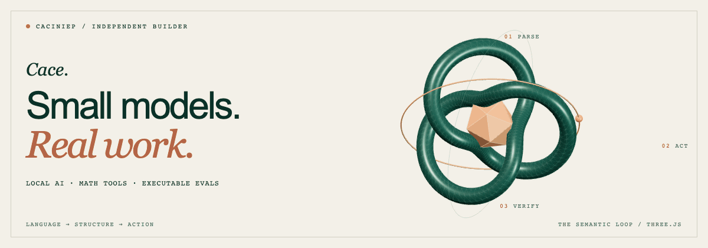
  </picture>

  <strong>构建本地优先的 AI 工具与可靠 Agent。</strong> 
  关注小模型工具调用、多模态数学写作与可执行评测。把语言学训练用于意图解析、上下文组织和工具接口设计。

  <a href="https://caciniep.github.io/">Portfolio</a> ·
  <a href="https://linguistwantstech.online/">研究与工程笔记</a> ·
  <a href="mailto:cacinie@gmail.com">Email</a> ·
  <a href="./README.en.md">English</a>

---

## 语码游戏 / Codetics

<a href="https://codetics.vercel.app/">
  <picture>
    <source media="(prefers-reduced-motion: reduce)" srcset="./assets/projects/codetics-scene.png" />
    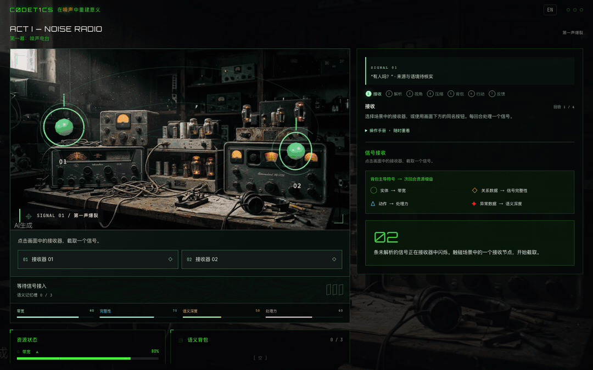
  </picture>
</a>

四景一盘：接收信号、语义标注、修辞拆解、巴别语义场

<a href="https://codetics.vercel.app/">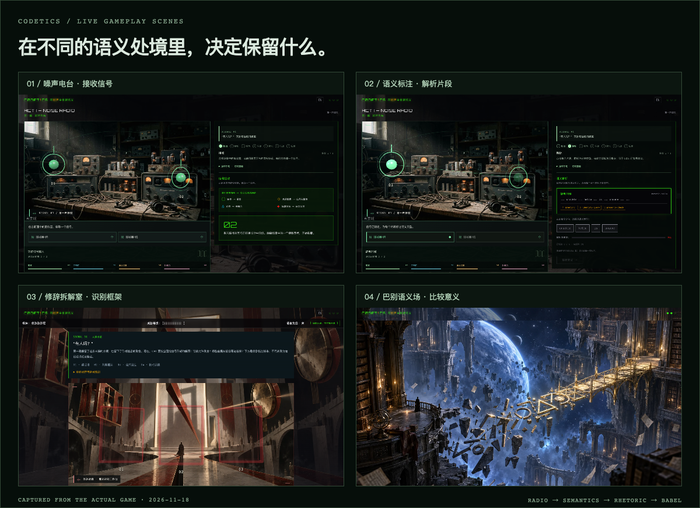</a>

**在噪声中重建意义。**

从噪声电台接收信号、标注语义、选择压缩策略，到修辞拆解与巴别语义场，语言学与信息论成为玩家实际操作的规则。当信息不断被压缩、误解与重述，文明还能留下多少意义？

[进入语码游戏 ↗](https://codetics.vercel.app/) · 中英双语 · 进度保存在当前浏览器 · 附加短篇《仍在唱歌的空城》

## 数学与语言工具

<table>
<tr>
<td width="50%" valign="top">
<strong><a href="https://github.com/CacinieP/TeXada-the-Math-Agent">TeXada</a></strong>

自然语言、截图与 LaTeX → 可检查的公式候选。专用工具负责检查、修复与渲染。

<a href="https://github.com/CacinieP/TeXada-the-Math-Agent/releases">下载 ↗</a> · <a href="https://openbmb.cn/docs/showcase/texada-math-agent">OpenBMB 官网 · 开发者精选 ↗</a>
</td>
<td width="50%" valign="top"><a href="https://github.com/CacinieP/TeXada-Studio-with-agentskills">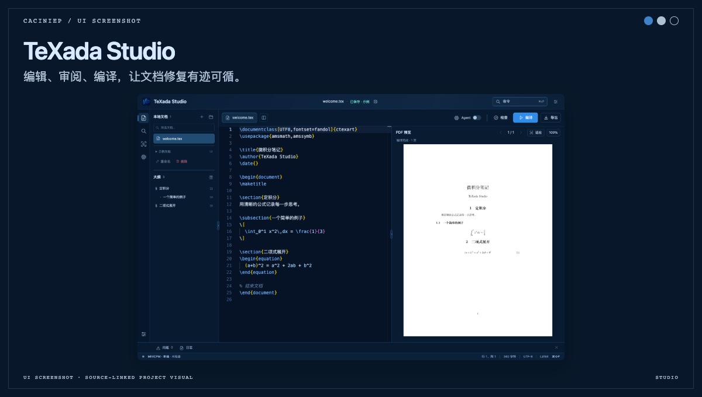</a>
<strong><a href="https://github.com/CacinieP/TeXada-Studio-with-agentskills">TeXada Studio</a></strong>

本地编辑、候选 diff、人工采用与 PDF 编译导出。当前为开发候选。

<a href="https://github.com/CacinieP/TeXada-Studio-with-agentskills/blob/main/docs/current-validation.md">验证记录 ↗</a>
</td>
</tr>
<tr>
<td width="50%" valign="top"><a href="https://github.com/CacinieP/launchgrid">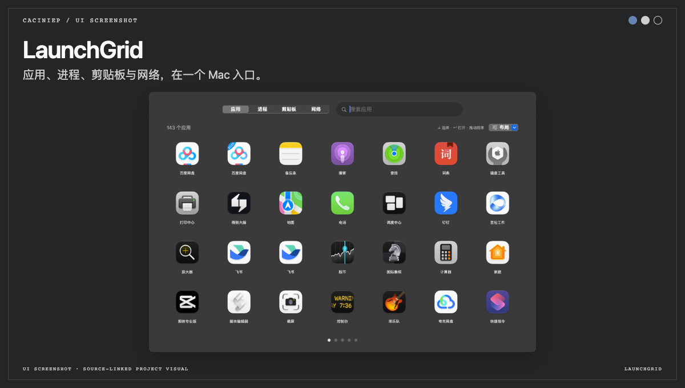</a>
<strong><a href="https://github.com/CacinieP/launchgrid">LaunchGrid</a></strong>

Mac 应用启动与整理，集成进程、剪贴板和网络面板。

<a href="https://github.com/CacinieP/launchgrid/releases">下载 ↗</a>
</td>
<td width="50%" valign="top"><a href="https://github.com/CacinieP/lang-master">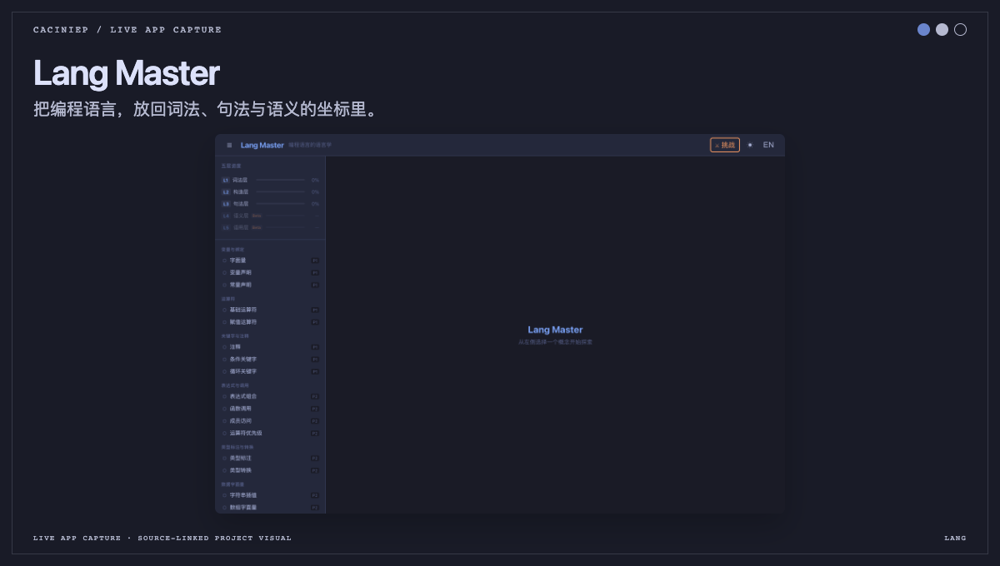</a>
<strong><a href="https://github.com/CacinieP/lang-master">Lang Master</a></strong>

从词法、构造、句法、语义与语用的对照理解编程语言。

<a href="https://caciniep.github.io/lang-master/">在线体验 ↗</a>
</td>
</tr>
</table>

## SMAB / 可执行的小模型评测

**让每一次失败，都能回到具体的协议、动作与轨迹。**

- **把模型能力与协议适配分开。** 先探测端点的工具调用、模板和结构化输出支持，再比较 native / JSON 等通道，减少把运行时差异误当成模型差距。
- **定位失败发生在哪一步。** 分别检查工具选择、参数、依赖顺序、状态跟踪、恢复与停止，并按任务长度观察能力边界；每次调用都有完整轨迹。
- **用重复实验衡量可靠性。** 保存每次运行，报告均值、标准差与 pass^k，观察同一任务能否连续成功。
- **方便本地迭代与回归。** 中英双语短任务、可修改的案例与确定性的工具 fixture，适合小模型、量化和提示方案的受控对照；基准工具不产生真实业务副作用。

[运行 SMAB](https://github.com/CacinieP/SMAB#快速开始) · [协议适配方法](https://github.com/CacinieP/SMAB/blob/main/docs/FRAMEWORK_ADAPTATION.md) · [原始轨迹与重复实验](https://github.com/CacinieP/SMAB/tree/main/docs/evidence/minicpm-local-r3-2026-11-16)

## 溯时 SUSHI / 把时间端上桌

**回转寿司，是溯时组织专注时间的隐喻。**

传送带上经过的是不同分量的专注：5 分钟的小点、15 分钟的甜品、30 分钟的主菜、60 分钟的大餐，也可以自选时长。选一盘适合此刻精力的寿司，再绑定或抽取一件任务，开始一段具体的专注。

完成的专注积成盘数；任务、守护者与笔记留下这一段时间的内容。从“今天还剩多少时间”，转向“此刻愿意端起哪一盘”。

[App Store 下载 ↗](https://apps.apple.com/app/id6779997923) · iOS / iPadOS · 数据本地保存 · 无需登录

## Agent 技能与数据工具

<table>
<tr>
<td width="50%" valign="top"><a href="https://github.com/CacinieP/slide-recipes">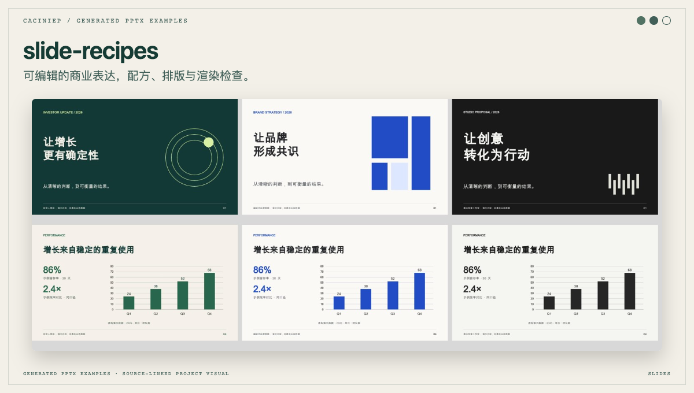</a>
<strong><a href="https://github.com/CacinieP/slide-recipes">slide-recipes</a></strong>

给 Agent 的可编辑 PPTX 配方，包含中文排版与渲染检查。

<a href="https://github.com/CacinieP/slide-recipes#readme">使用说明 ↗</a>
</td>
<td width="50%" valign="top"><a href="https://github.com/CacinieP/video2knowledge">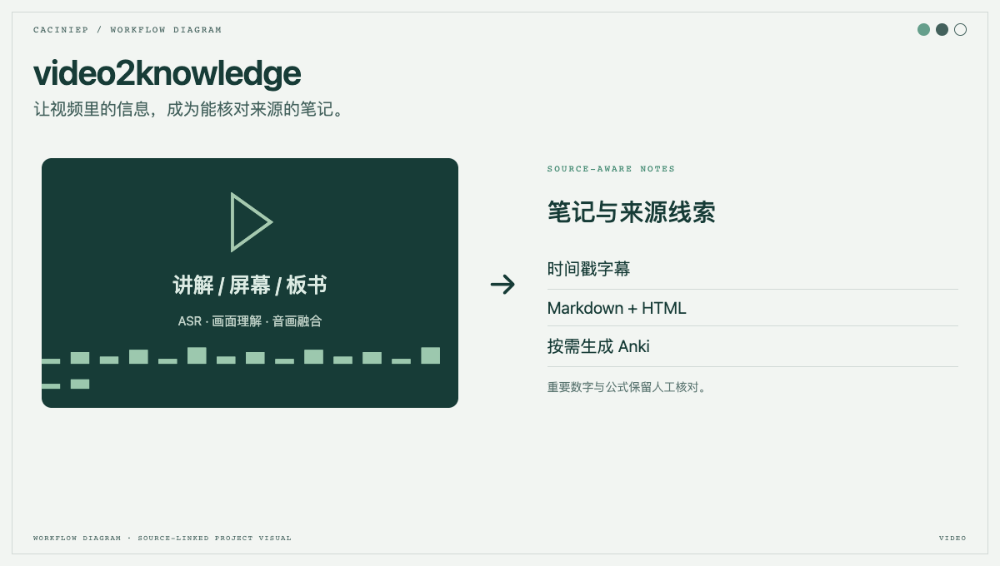</a>
<strong><a href="https://github.com/CacinieP/video2knowledge">video2knowledge</a></strong>

把视频转成带来源线索的笔记，按需生成字幕、HTML 与 Anki。

<a href="https://github.com/CacinieP/video2knowledge/tree/main/example">产物示例 ↗</a>
</td>
</tr>
<tr>
<td width="50%" valign="top"><a href="https://github.com/CacinieP/minicpm5-network-doctor">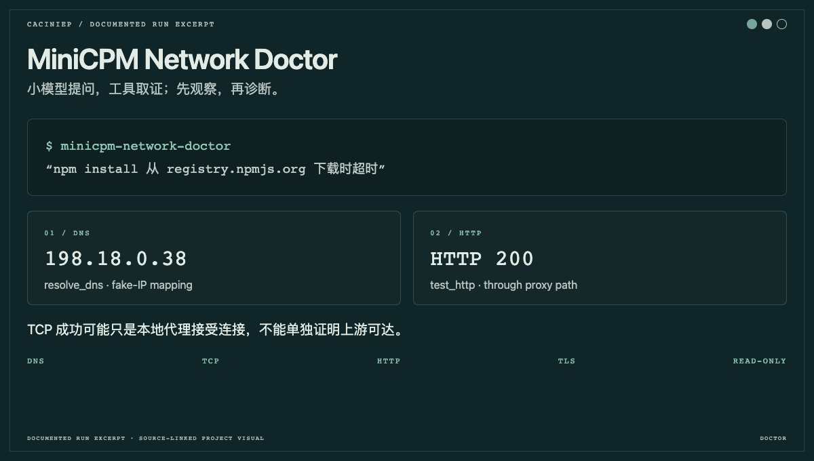</a>
<strong><a href="https://github.com/CacinieP/minicpm5-network-doctor">MiniCPM Network Doctor</a></strong>

本地小模型做只读网络诊断，结论保留工具证据。

<a href="https://github.com/CacinieP/minicpm5-network-doctor#readme">源码与说明 ↗</a>
</td>
<td width="50%" valign="top"><a href="https://github.com/CacinieP/FinancialBeancount">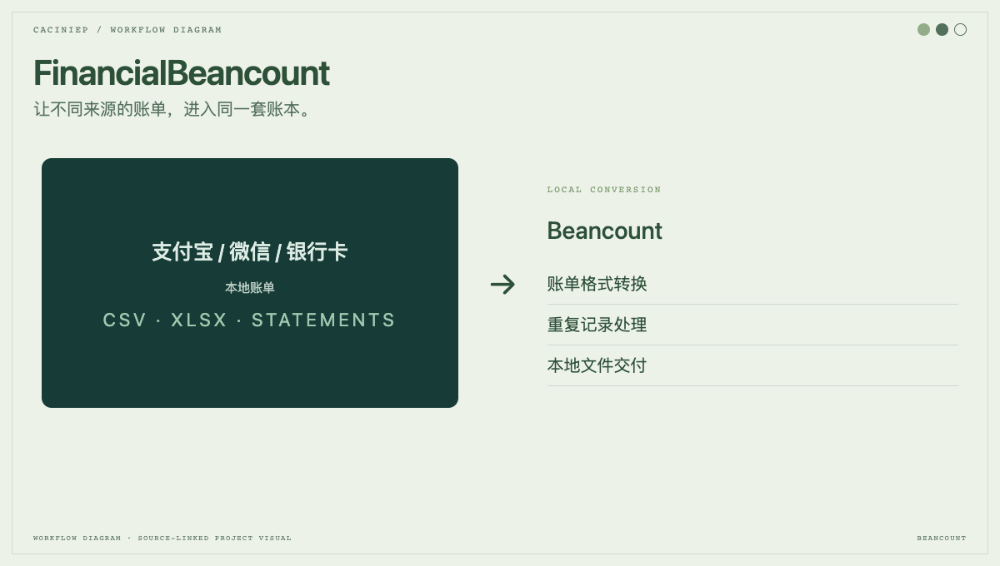</a>
<strong><a href="https://github.com/CacinieP/FinancialBeancount">FinancialBeancount</a></strong>

支付宝、微信、银行卡账单的本地转换与去重。

<a href="https://github.com/CacinieP/FinancialBeancount#readme">使用说明 ↗</a>
</td>
</tr>
</table>

## 开源贡献

参与工具链修复、测试与文档改进。下表仅列已合并的上游 PR；优先展示与当前工程方向相关的贡献，链接可查看具体改动。

<!-- START: oss-contributions -->
<!-- This block is auto-generated by .github/workflows/update-contributions.yml — do not edit by hand. -->
_10 merged PRs across 5 repos · auto-updated daily._

| Project | My merged PRs |
|---|---|
| [**cc-switch**](https://github.com/farion1231/cc-switch) | [#7099](https://github.com/farion1231/cc-switch/pull/7099) — fix(claude): allow npm scripts in the primary update path |
| [**Step-Code**](https://github.com/stepfun-ai/Step-Code) | [#16](https://github.com/stepfun-ai/Step-Code/pull/16) — test: add comprehensive test suite (848 tests, 11 files) |
| [**rust**](https://github.com/rust-lang/rust) | [#160538](https://github.com/rust-lang/rust/pull/160538) — Update expect messages in tcp.rs doc examples to follow the style guide |
| [**agent-skills-with-anthropic**](https://github.com/datawhalechina/agent-skills-with-anthropic) | [#1](https://github.com/datawhalechina/agent-skills-with-anthropic/pull/1) [#5](https://github.com/datawhalechina/agent-skills-with-anthropic/pull/5) [#8](https://github.com/datawhalechina/agent-skills-with-anthropic/pull/8) |
| [**video-devour**](https://github.com/datawhalechina/video-devour) | [#24](https://github.com/datawhalechina/video-devour/pull/24) [#28](https://github.com/datawhalechina/video-devour/pull/28) [#29](https://github.com/datawhalechina/video-devour/pull/29) [#30](https://github.com/datawhalechina/video-devour/pull/30) |
<!-- END: oss-contributions -->

## 研究与学习

数学、语言与推理系统：笔记、实验和其他项目

下图为项目内容索引示意。

<table>
<tr>
<td width="50%" valign="top"><a href="https://github.com/CacinieP/inference-optimization-index">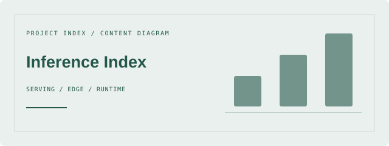</a>
<a href="https://github.com/CacinieP/inference-optimization-index"><strong>推理优化索引</strong></a> 服务端、端侧与通用推理资料。
</td>
<td width="50%" valign="top"><a href="https://github.com/CacinieP/agent-self-evolution">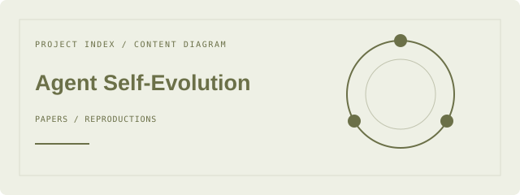</a>
<a href="https://github.com/CacinieP/agent-self-evolution"><strong>Agent 自演化</strong></a> 论文、复现与原型档案。
</td>
</tr>
<tr>
<td width="50%" valign="top"><a href="https://github.com/CacinieP/AgentEvalOps">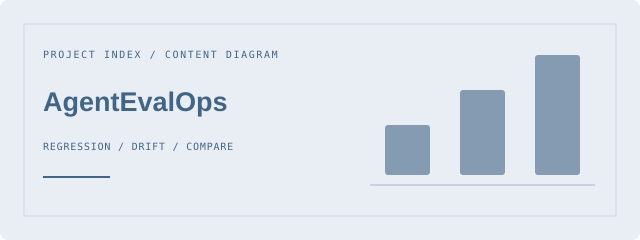</a>
<a href="https://github.com/CacinieP/AgentEvalOps"><strong>AgentEvalOps</strong></a> 回归、漂移与运行比较的前端原型。
</td>
<td width="50%" valign="top"><a href="https://github.com/CacinieP/math-to-deep-learning">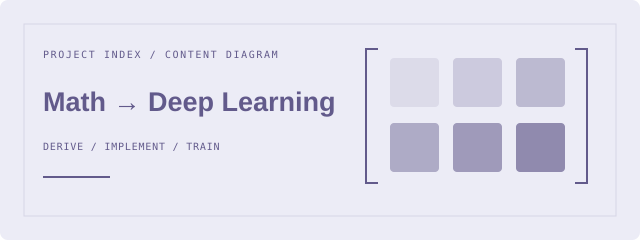</a>
<a href="https://github.com/CacinieP/math-to-deep-learning"><strong>数学到深度学习</strong></a> 从纸笔推导到 GPU 训练。
</td>
</tr>
</table>

<table>
<tr>
<td width="50%" valign="top"><a href="https://github.com/CacinieP/Mathematics-Universe">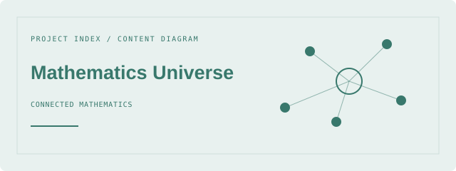</a>
<a href="https://github.com/CacinieP/Mathematics-Universe"><strong>数学联系网络</strong></a> 高中到考研的数学联系。
</td>
<td width="50%" valign="top"><a href="https://github.com/CacinieP/MathConnect">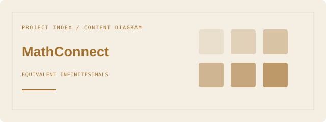</a>
<a href="https://github.com/CacinieP/MathConnect"><strong>MathConnect</strong></a> 等价无穷小的微积分连连看。
</td>
</tr>
<tr>
<td width="50%" valign="top"><a href="https://github.com/CacinieP/linguistics-hackathon-S0-deutsch">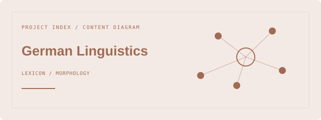</a>
<a href="https://github.com/CacinieP/linguistics-hackathon-S0-deutsch"><strong>德语语言学黑客松</strong></a> 一人 48 小时语言学习实验。
</td>
<td width="50%" valign="top"><a href="https://github.com/CacinieP/typing-master">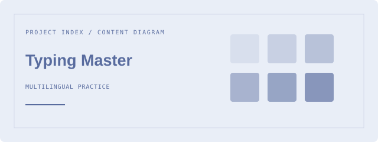</a>
<a href="https://github.com/CacinieP/typing-master"><strong>多语言打字练习</strong></a> 多语言键盘输入与练习。
</td>
</tr>
</table>

<table>
<tr>
<td width="50%" valign="top"><a href="https://github.com/CacinieP/music-research">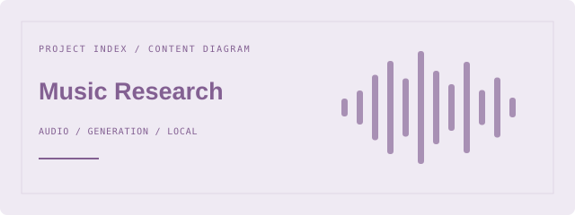</a>
<a href="https://github.com/CacinieP/music-research"><strong>音乐研究</strong></a> 音乐理解、生成、音频工程与端侧部署。
</td>
<td width="50%" valign="top"><a href="https://github.com/CacinieP/FinancialBeancount">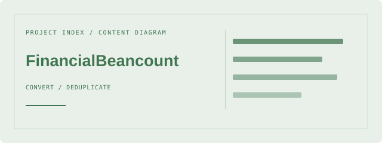</a>
<a href="https://github.com/CacinieP/FinancialBeancount"><strong>FinancialBeancount</strong></a> 账单本地转换与去重。
</td>
</tr>
<tr>
<td width="50%" valign="top"><a href="https://github.com/CacinieP/CICPA-Learning">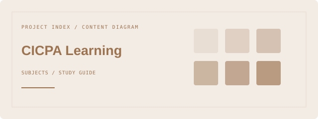</a>
<a href="https://github.com/CacinieP/CICPA-Learning"><strong>CPA 学习手册</strong></a> 科目索引与学习资料。
</td>
<td width="50%" valign="top"><a href="https://github.com/CacinieP/LPQE-Learning">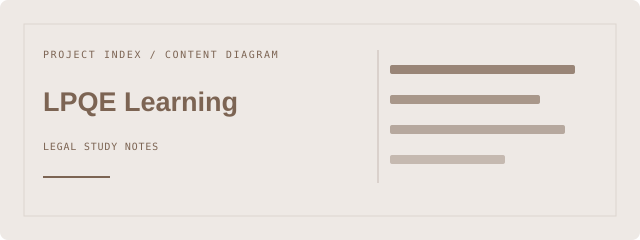</a>
<a href="https://github.com/CacinieP/LPQE-Learning"><strong>法考笔记</strong></a> 法律职业资格考试学习笔记。
</td>
</tr>
</table>

**常用技术** · Python / TypeScript / Swift / Rust · MCP / Tool Use / VLM / ASR · Tauri / React / GitHub Actions

---

[全部仓库](https://github.com/CacinieP?tab=repositories) · [个人网站](https://caciniep.github.io/) · [联系我](mailto:cacinie@gmail.com)
